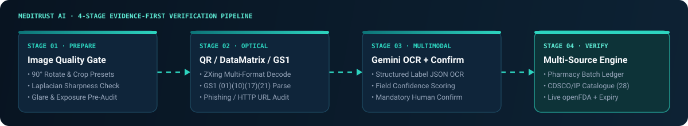
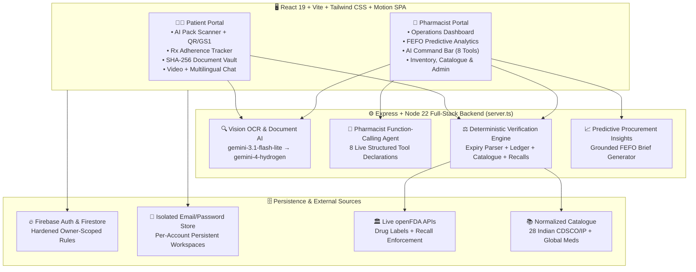
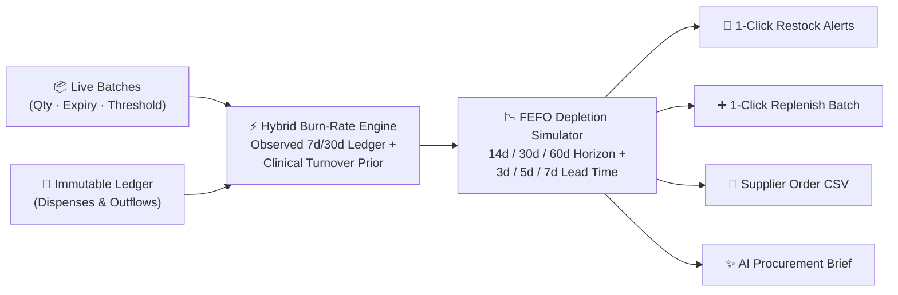

<div align="center">
  

  <br/>
  <br/>

  <!-- Animated Typing Subtitle -->
  <a href="#-how-the-meditrust-ai-model-works">
    
  </a>

  <br/>
 

  <!-- Visual Tech Stack & Capability Badges -->
  <p>
    
    
    
    
    
    
    
    
  </p>

  <!-- Quick Navigation Bar -->
  <p>
    <a href="#-why-meditrust-ai">✨ Why MediTrust</a> •
    <a href="#-how-the-meditrust-ai-model-works">🔬 AI Pipeline</a> •
    <a href="#-system-architecture">🏗️ Architecture</a> •
    <a href="#-dual-portal-experience">🧑‍⚕️ Dual Portals</a> •
    <a href="#-pharmacist-ai-operations-agent-8-real-tools">🤖 8 AI Tools</a> •
    <a href="#-predictive-inventory-analytics">📈 Forecasting</a> •
    <a href="#-quick-start--deployment">🚀 Deploy</a>
  </p>
</div>

---
live link=https://meditrust-ai.ai.studio/

## ✨ Why MediTrust AI?

Most "medicine scanner" demos make an unsafe mistake: they look at one photo and guess **"Genuine"** or **"Fake"**. Real pharmaceutical verification cannot be determined from pixels alone.

**MediTrust AI** is built as a **clinical-grade, evidence-first safety platform** with two dedicated portals — one for **Patients & Caregivers** and one for **Licensed Pharmacists & Supply Chains**:

| 🎯 Core Principle | 💡 How MediTrust AI Delivers It |
| :--- | :--- |
| **Zero Hallucinated Authenticity** | Uses **5 non-binary verification statuses** (`verified_match`, `needs_review`, `mismatch_suspicious`, `not_found`, `provider_unavailable`) backed by real evidence sources. |
| **Real Operational AI (Not Just Chat)** | Pharmacists can run **8 live Gemini Function-Calling tools** to receive stock, dispense units, quarantine suspect batches, log custody hand-offs, and export Purchase Orders. |
| **Proactive FEFO Forecasting** | Projects daily burn rate, stockout dates, and expiry cutoffs to recommend **restocking alerts & exact reorder quantities** before shelves run empty. |
| **Immutable Audit & Custody Trail** | Every stock movement, reconciliation, distributor dispatch, and AI action writes to an **append-only ledger & audit log**. |
| **Accessible to Everyone** | Full **English, Hindi (देवनागरी), and Hinglish** support across the landing page, scanner, portals, and AI Safety Assistant. |

---

## 🔬 How the MediTrust AI Model Works

<div align="center">
  
</div>

### 🚦 Non-Binary Verification Status Guide

Every scan and document resolves to a clear, auditable clinical status — never an unverified guess:

| Status Badge | Code | What Triggered It | Recommended Action |
| :--- | :--- | :--- | :--- |
|  | `verified_match` | Exact match confirmed against the **Authorized Pharmacy Batch Ledger** (valid shelf life, no recall). | Safe to track or dispense per prescription. |
|  | `needs_review` | Product matched **CDSCO/IP Reference Catalogue** or **openFDA Label**, but manufacturer serialization is not connected. | Verify invoice, tamper seal, and pharmacy source. |
|  | `mismatch_suspicious` | **Active FDA recall**, **expired date**, ledger conflict, or document tampering/anomalies found. | **Do not consume/dispense.** Quarantine & escalate. |
|  | `not_found` | Medicine/batch was not found in authorized ledger, catalogue, or openFDA feeds. | Confirm spelling/batch number with pharmacist. |
|  | `provider_unavailable` | External regulatory API timed out or was temporarily unreachable. | Retry verification or check manual reference. |

---

## 🏗️ System Architecture



---

## 🧑‍⚕️ Dual Portal Experience

<table>
<tr>
<td width="50%" valign="top">

### 👤 Patient & Caregiver Portal

- 📸 **4-Step AI Medicine Scanner**
  - Rotate/crop + sharpness & glare quality check
  - Live **ZXing QR / DataMatrix / EAN / GS1-128** decoder + URL phishing risk audit
  - Structured Gemini OCR + editable confirmation screen
- 💊 **Prescription & Dose Adherence Tracker**
  - Add manually or **auto-import** medicines from scanned prescription docs
  - Track daily doses, status (`active`, `paused`, `completed`), and linked batches
- 🔐 **Secure Document Vault**
  - Upload prescriptions, bills, lab reports, leaflets, or COAs
  - Client-side **SHA-256 hash** + AI anomaly & completeness inspection
- 💬 **Multilingual Safety AI Assistant**
  - Chat in **English, हिन्दी, or Hinglish**
  - Pin saved scans/docs, attach PDFs/photos, or upload **packaging videos** for timestamped (`MM:SS`) frame inspection

</td>
<td width="50%" valign="top">

### 🏥 Pharmacist & Supply Chain Portal

- 📊 **Pharmacy Operations Dashboard**
  - Editable Store Name, Drug License No. & City
  - Live stock KPIs, shelf-life distribution bar & priority watchlist
- 🤖 **AI Pharmacy Operations Agent**
  - Natural-language command bar directly on Dashboard, Inventory & Copilot
  - Executes **8 real tools** with 1-click confirmation or Auto-Execute mode
- 📈 **Predictive Inventory Analytics**
  - FEFO stock depletion SVG chart + burn-rate trends
  - 1-click Restocking Alerts, Replenishment & Common Essentials gap filling
- 📦 **Inventory, Catalogue & Reconciliation**
  - Auto-seeded **8-batch starter stock** on onboarding
  - **Bulk CSV/JSON upload** (+ template), **28-product Catalogue**, **Pack OCR Receipt**, and **Physical vs. Ledger Reconciliation**
- 🔗 **Traceability, Review Queue & Admin Console**
  - End-to-end custody timeline, live connector probes, Web Notifications & Audit Log exports

</td>
</tr>
</table>

---

## 🤖 Pharmacist AI Operations Agent (8 Real Tools)

Unlike basic chatbots, the **MediTrust Pharmacist AI Agent** uses real **Gemini Function Calling** (`POST /api/v1/pharmacist/ai-agent`) connected to live inventory, alerts, and custody timelines. Every executed action writes an immutable `AI_AGENT_*` entry to the Audit Log.

> 💬 **Try saying in English, Hindi, or Hinglish:**
> - *"Dispense 10 units of Dolo-650 from current stock for counter sale."*
> - *"Receive 100 strips of Crocin Advance batch CRC-2026-905 expiring 2028-06-30 from MedLine Distributors at Rs 22."*
> - *"Quarantine batch GGP1-25M18 because seal looked tampered and alert staff."*
> - *"Check all low-stock and near-expiry batches and generate a supplier reorder purchase order."*

<details>
<summary><b>🛠️ Click to expand all 8 Live Pharmacist AI Tools</b></summary>
<br/>

| # | Tool Name | What It Actually Executes in Your Live Database |
| :-: | :--- | :--- |
| 1 | `receive_stock_batch` | Adds a new batch to `inventory_batches`, appends a `RECEIPT` ledger row, logs a `RECEIVED` custody event, and auto-enriches manufacturer/composition/MRP from the 28-medicine catalogue. |
| 2 | `record_stock_movement` | Posts `DISPENSE`, `RECEIPT`, `RETURN`, `ADJUSTMENT`, `TRANSFER`, or `RECONCILIATION` entries to `inventory_ledger` and updates stock balances atomically. |
| 3 | `quarantine_or_flag_batch` | Flags a batch `mismatch_suspicious` + `recallFlagged = true`, appends a `QUARANTINED` traceability event, and raises a critical alert. |
| 4 | `create_safety_alert` | Creates an actionable staff alert (`expired`, `near_expiry`, `low_stock`, `recall`, `mismatch`, `document_flag`) in `alerts`. |
| 5 | `resolve_safety_alert` | Acknowledges or resolves matching open safety alerts with an audit note. |
| 6 | `log_distributor_handoff` | Appends upstream `DISPATCHED` or downstream custody events into `traceability_events`. |
| 7 | `generate_reorder_purchase_order` | Computes a full supplier Purchase Order (`PO-YYYYMMDD-XXX`) with recommended order quantities, INR cost estimates, and a downloadable **PO CSV**. |
| 8 | `audit_pharmacy_risk_summary` | Runs an instant pharmacy-wide risk audit across expired stock, near-expiry batches, low stock, quarantine flags, missing distributor dispatches, and pending review scans. |

</details>

---

## 📈 Predictive Inventory Analytics

Built directly into the **Pharmacy Operations Dashboard**, the forecasting engine turns stock & ledger history into concrete restocking decisions:



- **Interactive SVG Depletion Chart:** Click any medication row to inspect its projected FEFO curve, dashed **Reorder Threshold** line, batch expiry cutoffs, and exact **Stockout Day** marker.
- **Common Essentials Coverage Gap:** Monitors 12 high-turnover Indian pharmacy essentials (*Dolo-650, Azithral 500, Pan-D, Augmentin 625 Duo, Telma 40, Glycomet-GP 1, Montair LC, Shelcal 500, Crocin Advance, Ecosprin 75, Thyronorm 50, Electral ORS*) and flags any missing essentials with 1-click **Add Initial Stock**.

---

## 📚 Curated Datasets & API Reference

<details>
<summary><b>📦 Included Medicine Catalogue (28) & Starter Stock Dataset (8)</b></summary>
<br/>

- **Normalized Medicine Reference Catalogue (`28` curated entries):**
  - **India (CDSCO / IP):** *Dolo-650, Augmentin 625 Duo, Azithral 500, Pan-D, Telma 40, Glycomet-GP 1, Ecosprin 75, Shelcal 500, Allegra 120, Montair LC, Crocin Advance, Calpol 500, Thyronorm 50, Atorva 10, Omez 20, Combiflam, Limcee 500, Zincovit, Amlokind 5, Metpure-XL 50, Okacet, Becosules, Electral ORS, Asthalin Inhaler*.
  - **US / Global (FDA / USP):** *Tylenol Extra Strength, Advil 200, Glucophage 500, Lipitor 20*.
- **Pharmacist Starter Stock Dataset (`8` dynamic-date batches):**
  - Auto-seeded on Pharmacist onboarding (and loadable anytime via **Load Starter Dataset**) covering healthy stock, near-expiry watchlist items, low-stock reorder triggers, upstream distributor hand-offs, and a `needs_review` batch.
- **Custom Batch Uploads:** Upload your own **CSV or JSON** batch files (with downloadable template) and automatic metadata enrichment.

</details>

<details>
<summary><b>🔌 Backend REST API Endpoints (/api/v1/*)</b></summary>
<br/>

| Method | Endpoint | Purpose |
| :--- | :--- | :--- |
| `GET` | `/api/v1/health?probe=true` | Service status, active Gemini models, catalogue size, connector flags & live openFDA latency ping |
| `GET` | `/api/v1/catalogue?q=` | Search the Normalized Indian (CDSCO/IP) & Global Medicine Reference Catalogue |
| `POST` | `/api/v1/scans/extract` | Multimodal Gemini Vision OCR extracting structured medicine label fields |
| `POST` | `/api/v1/verifications` | Multi-source deterministic verification (Ledger + Catalogue + live openFDA + Expiry Parser) |
| `POST` | `/api/v1/documents/verify` | AI document structure, entity & anomaly verification for prescriptions/invoices/COAs |
| `POST` | `/api/v1/chat` | Grounded multilingual AI assistant (EN/HI/Hinglish) with image, PDF & video frame inspection |
| `POST` | `/api/v1/pharmacist/ai-agent` | Live Gemini Function-Calling agent returning executable pharmacy actions, POs & Risk Audits |
| `POST` | `/api/v1/pharmacist/predictive-insights` | Grounded bilingual AI Procurement Brief based on computed FEFO forecast metrics |
| `POST` | `/api/v1/account/*` | Isolated Email/Password authentication & per-account persistent workspace CRUD |

</details>

<details>
<summary><b>🔒 Data Security, Tenant Isolation & Clinical Safety Guardrails</b></summary>
<br/>

- **10 Owner-Isolated Collections:** `users`, `scans`, `prescriptions`, `verified_documents`, `inventory_batches`, `inventory_ledger`, `traceability_events`, `alerts`, `chat_messages`, `audit_events`.
- **Append-Only Immutability:** `inventory_ledger`, `traceability_events`, and `audit_events` cannot be edited or deleted once committed.
- **Server-Only AI Keys:** All `@google/genai` calls execute strictly on the Express backend using `process.env.GEMINI_API_KEY`; zero private secrets ever reach the client bundle.
- **Clinical Guardrails:** The assistant never diagnoses illnesses, prescribes treatment changes, or overrides deterministic verification outcomes.

</details>

---

## 🚀 Quick Start & Deployment

### 1️⃣ Environment Variables
Create a `.env` file from `.env.example`:

```env
NODE_ENV=production
PORT=3000
GEMINI_API_KEY="your-gemini-api-key"
SESSION_SECRET="optional-64-char-hex-secret"
APP_URL="http://localhost:3000"
```

### 2️⃣ Install & Run Locally

```bash
# Install dependencies
npm install

# Start full-stack development server (Express + Vite on http://localhost:3000)
npm run dev
```

### 3️⃣ Type-Check, Build & Production Start (Node.js 22+)

```bash
# TypeScript verification
npm run lint

# Build production frontend bundle into dist/
npm run build

# Start production server (Cloud Run / Docker / VPS ready)
NODE_ENV=production npm start
```

---

<div align="center">
  
</div>
